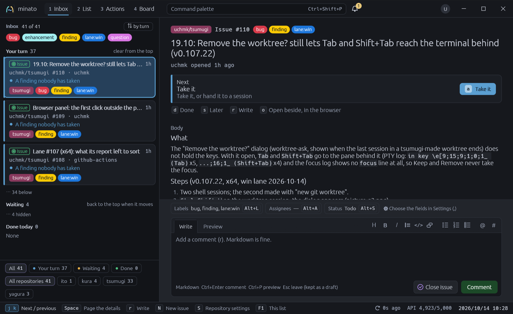
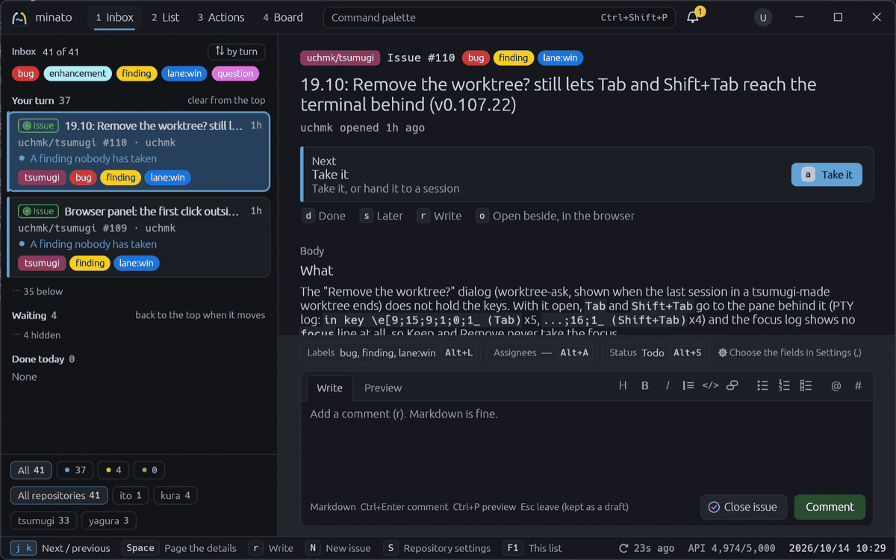
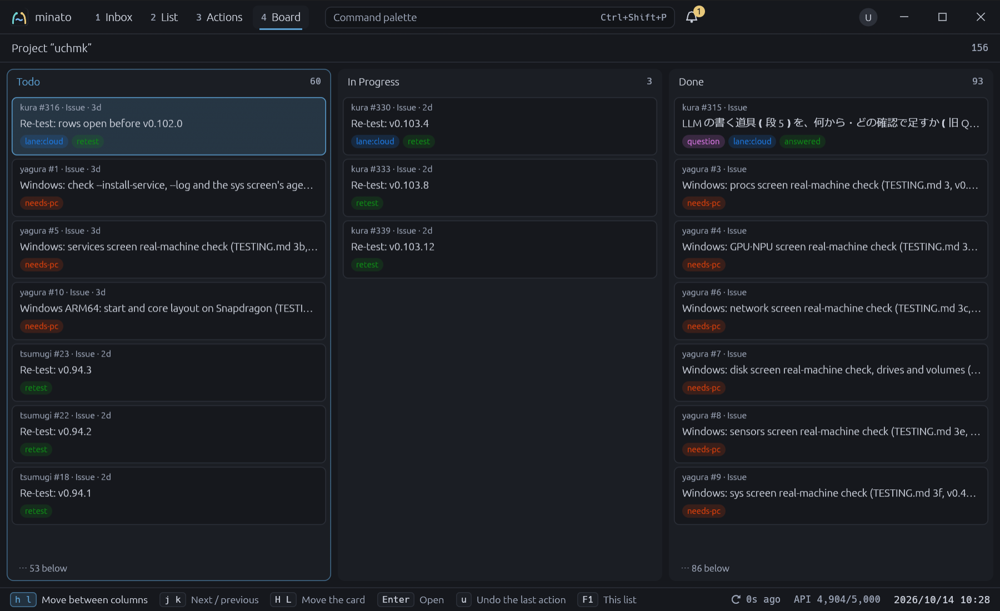

# minato

A keyboard-driven GitHub app for the issues, pull requests, discussions,
Actions runs and Project boards of several repositories at once. An inbox
shows only what is waiting for you and why; a three-column list finds the
rest. Rust + egui, Windows first, with macOS and Linux on x86_64 and ARM64.
A sibling of [tsumugi](https://github.com/uchmk/tsumugi) and
[yagura](https://github.com/uchmk/yagura), sharing their crates in
[ito](https://github.com/uchmk/ito).

**Status:** the inbox, the list, Actions, the Project board, the command
palette, notifications and writing (comments, labels and the other fields,
new issues, merge and close, each asking first) work against GitHub. The token
comes from `GITHUB_TOKEN`, `GH_TOKEN` or `gh auth token`. The screens were
agreed on an HTML mock first: open [docs/mock/minato.html](docs/mock/minato.html)
in a browser and press `?` for the keys. What the mock settles is written down
in [docs/design.md](docs/design.md); what is left, in [TODO.md](TODO.md).
The keys can be changed in `keymap.toml` in the `uchmk/minato` config folder,
the same way as in kura, yagura and tsumugi.

## What it looks like

